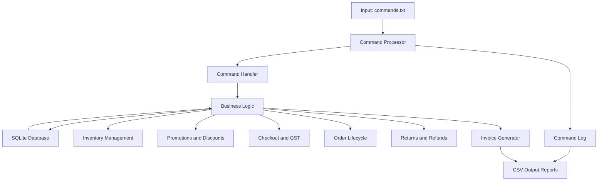
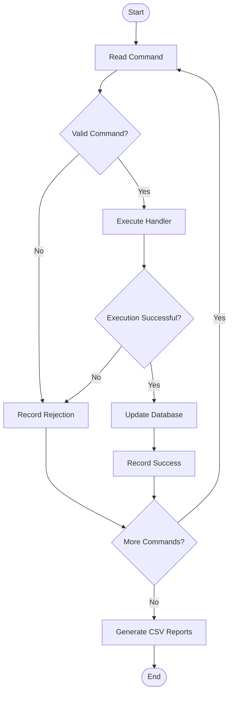
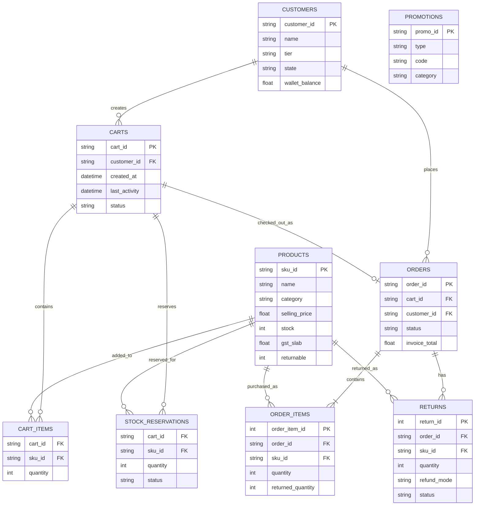
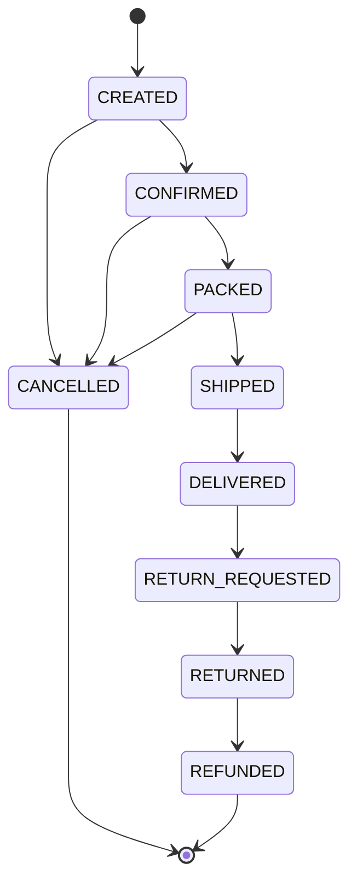

# PS-002: E-commerce Orders & Promotions Engine

## Project Overview
The E-commerce Orders & Promotions Engine is a Python-based application that manages product orders, inventory reservations, promotional discounts, checkout, GST calculations, order status updates, and product returns.

The application uses SQLite for database management and supports command-line operations.

## Technologies Used
- Python
- SQLite
- Pytest
- VS Code

## Main Features

### 1. Product Catalogue
- Product SKU and category management
- Selling price and stock management
- Product weight and GST rates
- Sale item identification

### 2. Customer Management
- Regular and Prime customers
- Customer state information

### 3. Cart and Inventory
- Add, remove, and update cart items
- Reserve stock when products are added
- Release stock when items are removed
- Automatically expire inactive carts after 30 minutes

### 4. Promotions and Discounts
- Percentage discounts
- Flat discounts
- Category-based offers
- Bank offers
- BOGO offers
- Coupon minimum order value validation
- Maximum discount limit

### 5. Checkout and GST
- Automated discount calculation
- CGST and SGST for intrastate orders
- IGST for interstate orders
- Shipping charge calculation
- Itemised invoice generation

### 6. Order Management
- CREATED
- CONFIRMED
- PACKED
- SHIPPED
- DELIVERED
- CANCELLED

### 7. Returns and Refunds
- Full and partial return requests
- Return eligibility validation
- Return approval and rejection
- Original payment refund recording
- Wallet refund with 2% bonus

## Project Structure

```text
T047-PS-002/
│
├── database/
│   ├── db.py
│   ├── add_to_cart.py
│   ├── reserve_stock.py
│   ├── release_stock.py
│   ├── expire_carts.py
│   └── ps002.db
│
├── tests/
│   ├── test_bogo.py
│   ├── test_discounts.py
│   ├── test_gst.py
│   └── test_shipping.py
│
├── output/
│   └── invoice.txt
│
├── checkout.py
├── calculate_discounts.py
├── create_order.py
├── update_order_status.py
├── process_return.py
├── update_return_status.py
└── README.md
```

## How to Run

### Step 1: Activate Virtual Environment

```powershell
venv\Scripts\activate
```

### Step 2: Install Pytest

```powershell
pip install pytest
```

### Step 3: Run the Application

Run the required Python modules from the project root directory.

For example:

```powershell
python checkout.py
```

### Step 4: Run Automated Tests

```powershell
python -m pytest -v
```

## Testing Results

The project currently has 15 automated tests.

| Test Module | Tests Passed |
|---|---:|
| BOGO | 4 |
| Discounts | 4 |
| GST | 3 |
| Shipping | 4 |
| **Total** | **15 / 15** |

Manual testing was also performed for order lifecycle transitions, returns, refund methods, and checkout operations.

## Database

SQLite is used to store:
- Products
- Customers
- Carts
- Stock reservations
- Promotions
- Orders
- Order items
- Returns

## Conclusion

The project demonstrates the implementation of an e-commerce order processing system using Python and SQLite, with inventory management, promotional calculations, checkout, taxation, order tracking, and return processing.

## 1. System Architecture



## 2. Order Processing Flowchart



## 3. Database Entity Relationship Diagram



## 4. Order Lifecycle Diagram




## 🎥 Project Demo

A demonstration video of our **PS-002 – E-commerce Orders, Promotions and Returns Engine** is available below.

The video demonstrates the major functionalities of our project, including:

- Product catalogue management
- Customer and cart management
- Stock reservation and cart expiry
- Discount and coupon calculations
- Checkout and GST calculations
- Order creation and order status updates
- Return processing and refund management

### 📹 Demo Video

[▶ Watch the Project Demonstration](https://drive.google.com/file/d/1Knj05n15i2DihUEqYrkDQZb3bYPGM-pM/view?usp=drivesdk)

The demonstration showcases the working implementation and key features of our project.
